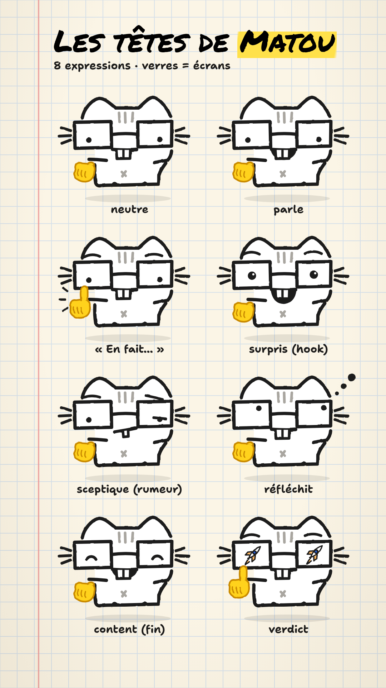

# Vids for RS — Matou (@matou.ai)

**L'actu de l'IA en 30 secondes. Un chat t'explique.** ☝️🤓

Vidéos courtes verticales (TikTok, Instagram Reels, YouTube Shorts, Threads) qui
expliquent au grand public les annonces et articles de blog des grands acteurs de l'IA,
présentées par Matou, un chat à lunettes dessiné à la main.



## Objectifs

1. **Informer** : rendre l'actualité IA claire, sourcée et utile en 30 à 45 secondes.
2. **Fidéliser** : une identité forte (design system, mascotte, rituels) pour que les
   viewers reconnaissent les vidéos au premier coup d'œil, s'abonnent et reviennent.
3. **Automatiser** : chaque matin, une routine choisit l'actu, produit la vidéo et la
   dépose en brouillons dans Postiz. Il ne reste qu'à relire et programmer.

## Comment ça tourne

| Quand | Routine (tâche planifiée) | Résultat |
| --- | --- | --- |
| Chaque matin | skill `episode-du-jour` | veille → épisode → brouillons Postiz pour 18 h, notification |
| Chaque après-midi | rappel de relecture | notification si des brouillons du jour attendent |
| Chaque lundi | skill `bilan` | chiffres par réseau, `docs/apprentissages.md`, `docs/sujets.md` |

**Ton rôle** : relire les brouillons dans Postiz, puis les programmer (dans Postiz, ou
en répondant « programme » dans la session de la routine). Rien ne part sans toi.

Diffusion par [Postiz](https://postiz.com) (cloud, formule Standard) : TikTok,
Instagram, YouTube et Threads connectés ; Facebook, LinkedIn, X et Bluesky sont gérés
par le script dès qu'ils sont connectés. Clé d'API dans la variable `POSTIZ_ENV`.

## Le site

Page d'accueil + blog dans un dépôt à part, [RubenVP2/jev-game](https://github.com/RubenVP2/jev-game) (Astro, statique sur Cloudflare Workers), qui lit les épisodes d'ici à chaque build. Chaque
épisode y devient un article, publié seul une fois la vidéo programmée. Détail et mise en
ligne : [`docs/site.md`](docs/site.md).

## Produire un épisode à la main

Dans une session Claude Code : donner le lien de l'article. Claude suit le skill
`episode` (source → script → relectures → voix → rendu → contrôles → publication →
brouillons Postiz).

```bash
npm ci
npm run validate -- 001 && npm run voice -- 001 && npm run render -- 001 && npm run check -- 001
npm run postiz -- 001 --commentaire --envoyer
```

## État du projet

- ✅ Phase 1 — Brainstorming & positionnement
- ✅ Phase 2 — Identité de marque
- ✅ Phase 3 — Moteur vidéo (épisode `#000` bande-annonce rendu)
- ✅ Phase 4 — Pilote `#001` (en brouillons dans Postiz)
- ✅ Phase 5 — Skills et sous-agents « 1 session = 1 vidéo »
- 🟡 **Phase 6 — Lancement** : routines quotidiennes et bilan hebdomadaire

| Document | Contenu |
| --- | --- |
| [`docs/design-system.md`](docs/design-system.md) | Le cahier de Matou : couleurs, typos, Matou, composants, son |
| [`docs/moteur.md`](docs/moteur.md) | Le moteur vidéo : commandes, voix, alignement, rendu |
| [`docs/site.md`](docs/site.md) | Le site (dépôt à part) : ce qu'il lit ici, quand un article est en ligne |
| [`docs/decisions.md`](docs/decisions.md) | Journal des décisions (tranchées et ouvertes) |
| [`docs/apprentissages.md`](docs/apprentissages.md) | Ce qui marche chez Matou, d'après les chiffres |
| [`docs/sujets.md`](docs/sujets.md) | Réserve de sujets pour les jours sans actu forte |
| [`docs/bilans/`](docs/bilans/) | Bilans hebdomadaires |
| [`docs/roadmap.md`](docs/roadmap.md) | Les phases du projet |
| [`docs/brainstorm.md`](docs/brainstorm.md) | Pistes explorées en phase 1 |
| [`CLAUDE.md`](CLAUDE.md) | Le contexte et les règles que Claude suit à chaque session |
