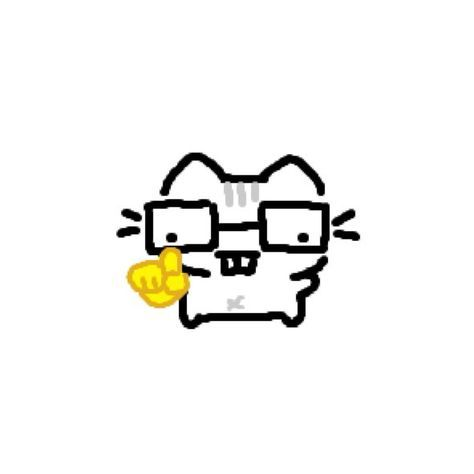

# Brainstorm — Vids for RS

> Document de travail. Rien n'est figé ici : les choix validés partent dans
> [`decisions.md`](decisions.md).
>
> Légende : ⭐ recommandation · ❓ question ouverte pour toi · ⚠️ point de vigilance · ✅ décidé

---

## 1. Positionnement ✅

- **Audience** : grand public + pros hors tech. Des gens intelligents qui ne sont
  pas dans la tech. Zéro jargon non expliqué.
- **Plateformes** : TikTok, Reels, Shorts. **Langue** : français.
- **Ton** : pédagogie grand public avant tout, avec une touche de fun.
- **Rythme** : 1 vidéo par jour (au minimum 1 tous les 2 jours).
- **Personne à l'écran** : seulement une voix et la mascotte.

**Promesse proposée** ⭐ : *« L'actu IA en 30 secondes. Claire, sourcée, sans bullshit. »*

---

## 2. L'inspiration Fireship, adaptée à 30 secondes

### Ce qui fait marcher Fireship

1. **Densité extrême** : aucune phrase de remplissage, chaque phrase apporte une info.
2. **Humour pince-sans-rire glissé dans l'info** : la blague est une phrase
   sèche au milieu de l'explication, pas un sketch. Environ une toutes les 10 secondes.
3. **Des visuels qui changent sans arrêt**, souvent ironiques (images détournées, memes).
4. **Une formule signature** : le titre annonce le format, donc on sait ce qu'on va avoir.
5. **Une voix rapide et assurée**, jamais de visage : la voix et le style suffisent.

### Ce que ça donne en 30 secondes

- **Une seule idée par vidéo.** À 100 secondes Fireship en développe plusieurs ;
  à 30 secondes, on en garde une seule, bien expliquée.
- **Budget texte : environ 75 à 85 mots** (voix rapide en français).
  Le script se dimensionne à partir de ce chiffre.
- **Une blague maximum**, souvent portée par une réaction de la mascotte plutôt
  que par le texte.
- **Formule de titre** ⭐ : *« [Sujet] en 30 secondes »*. Simple, explicite, et
  ça devient le format reconnaissable.

### Ce qu'on ne copie pas ⚠️

- Ses phrases signatures et son identité visuelle : on construit les nôtres.
- **Les memes et images d'autres créateurs** (droit d'auteur, risque de blocage).
  ⭐ **Nos memes, ce sont les réactions de la mascotte.** Le chat qui fait une tête
  sceptique joue le rôle du meme, ça nous appartient et ça renforce la marque à
  chaque vidéo.

---

## 3. Formats (séries)

À une vidéo par jour, la production doit être rodée. On commence simple.

| Série | Contenu | Durée |
| --- | --- | --- |
| **Flash** ⭐ (format principal) | Une news, expliquée | ~30 s |
| **Décrypté** | Un article de blog d'une grande boîte | 30–45 s |
| **Le Récap** *(plus tard)* | Le top 3 ou 5 de la semaine, rendez-vous fixe | 45–60 s |
| **Le Mot de l'IA** *(plus tard)* | Un concept expliqué (token, agent…) | ~30 s |

⭐ Lancer avec **Flash + Décrypté** sur le même squelette de 30 s, et ajouter
Le Récap une fois le pipeline stable.

---

## 4. Squelette d'une vidéo de 30 secondes

| Temps | Bloc | Contenu | Mots |
| --- | --- | --- | --- |
| 0–2 s | **Hook** | La phrase-choc. Pas de logo, pas de « Salut ! ». | ~6 |
| 2–6 s | **Contexte** | Qui, quoi, quand + la source à l'écran. | ~12 |
| 6–22 s | **L'explication** | L'idée unique, en 2 ou 3 temps visuels. | ~45 |
| 22–27 s | **Pourquoi ça compte** | L'impact concret pour le viewer. | ~15 |
| 27–30 s | **Verdict + signature** | Le Hype-mètre + la phrase de fin. | ~5 |

Règles de rythme :

- Sous-titres **toujours**, mot par mot (beaucoup regardent sans le son).
- Un changement visuel toutes les 2 secondes environ.
- Si la fin renvoie au début, le replay est plus naturel (et l'algorithme le compte).

---

## 5. Mécaniques de fidélisation

1. **Le Hype-mètre** ⭐ : la fin de chaque vidéo, en 2 secondes. Le chat donne son
   verdict : 🫧 *Pur buzz* · 🌱 *Prometteur* · 🚀 *Game changer*. Ça donne une
   raison de rester jusqu'au bout, ça lance le débat en commentaires, et ça
   devient ta signature.
2. **Numérotation des épisodes** (`#042`) : l'effet collection.
3. **Signature sonore** : un son court au moment du verdict (un « miaou » stylisé ?).
4. **Une couleur signature** : on reconnaît la vidéo dans le fil en moins d'une seconde.
5. **Phrase de fin récurrente** propre à la mascotte.
6. **Le lore du chat** : des running gags légers (il a peur de se faire remplacer
   par un modèle plus récent, il fait la sieste sur le clavier quand il n'y a pas
   d'actu…). Les habitués comprennent les clins d'œil.
7. **Répondre aux commentaires en vidéo** : contenu facile et très engageant.
8. **Rendez-vous fixe** : Le Récap, quand il arrivera.

---

## 6. La mascotte : Matou ✅ (direction validée, dessin à faire)



*Référence fournie : un chat blanc dessiné à la main, avec de grosses lunettes carrées,
des dents de lapin et le doigt levé jaune ☝️.*

### Mon analyse

**Verdict : excellente base.** Elle coche presque tout.

✅ **Les lunettes sont le trait distinctif idéal.** On les lit même en tout petit, et
elles règlent le problème du « chat parmi des millions ». En plus, **les verres
deviennent des écrans** : on y fait apparaître le logo de l'entreprise dont on parle,
une icône de chargement quand il réfléchit, un « ? », le verdict du Hype-mètre…
C'est le lien avec l'IA, sans le forcer.

✅ **Le doigt levé ☝️ est un code d'internet que tout le monde connaît** : le meme
« ☝️🤓 en fait… », celui qui corrige tout le monde. Pour une chaîne pédago, c'est
parfait : **Matou sait qu'il est un peu je-sais-tout et il l'assume.** C'est de
l'autodérision, exactement l'humour pince-sans-rire de Fireship.
→ **Le geste devient le rituel de chaque vidéo** : au début de l'explication, Matou
lève le doigt : *« ☝️ En fait… »*.

✅ **Le style « dessiné sous Paint » nous démarque.** Tous les comptes IA sont lisses,
brillants, néon. Un trait noir épais et tremblé, fait main, ressort dans le fil,
et c'est le langage natif des memes.
→ En animation, on garde le **trait qui frémit** (*boiling line* : le contour bouge
légèrement 8 à 12 fois par seconde, comme un dessin animé fait main). Matou a
l'air vivant en permanence, pour presque rien côté code.

✅ **Très simple** : une dizaine de formes. Corps blanc, contour noir, 3 rayures
grises, dents de lapin. Parfait pour le SVG et pour les états animés.

✅ **La palette est déjà là** : noir, blanc, et **le jaune du doigt comme couleur
signature**. Le jaune ressort très bien dans le fil et évite le cliché violet des
comptes IA.

⚠️ **Droits : on ne peut pas utiliser ce dessin tel quel.** Cette image de chat
circule comme meme (variante du « nerd emoji ☝️🤓 », voir aussi le
[Nerd Dog](https://knowyourmeme.com/memes/nerd-dog)) et son auteur est inconnu. Le
concept n'appartient à personne, mais le dessin si. **On dessine notre propre Matou**
à partir de cette idée (proportions, rayures, lunettes à nous). Même chose pour la
main jaune : elle ressemble à l'emoji d'Apple, on la redessine dans notre style.
*(Si c'est toi qui l'as dessiné, dis-le-moi : ça change tout.)*

⚠️ **Un chat blanc disparaît sur fond blanc.** Il faut un fond coloré ou sombre (le
contour noir aide aussi). À trancher avec la palette.

⚠️ **Le meme vieillira.** Le ☝️ est un point d'entrée, pas toute la personnalité :
Matou doit aussi exister par ses autres expressions et son lore.

❓ **La petite croix grise sur le ventre** : intentionnelle ? On peut la garder comme
signe distinctif (sa « cicatrice de bug » 🐛, idéal pour le lore) ou l'enlever.

### Les états de Matou

| État | Corps | Lunettes / yeux |
| --- | --- | --- |
| Neutre / parle | Assis, la bouche bouge | Yeux normaux |
| **« En fait… »** ☝️ | Doigt levé | Reflet qui brille sur les verres |
| Surpris | Poils hérissés, oreilles droites | Yeux énormes, lunettes qui sautent |
| Sceptique | Une oreille de côté | Paupières mi-closes, il baisse ses lunettes |
| Réfléchit | La patte sous le menton | Icône de chargement dans les verres |
| Content | Se dandine | Yeux en « ^^ » |
| Verdict | Face caméra | 🫧 / 🌱 / 🚀 affiché dans les verres |

### Qui parle ?

⭐ **Matou parle.** La voix *est* Matou. En V2, ta voix devient la sienne : il devient
ton avatar. C'est le plus cohérent puisque tu n'apparais jamais.

### Phrases signatures (pistes)

- Ouverture de l'explication : *« ☝️ En fait… »*
- Fin : ⭐ *« C'était Matou, et c'est tout. »*, ou une variante qui rime avec Matou.

---

## 7. Nom de la chaîne ✅

**Matou**, pseudo **`@matou.ai`** sur TikTok, Instagram et YouTube.

- Le chat et la chaîne portent le même nom : on s'abonne à un personnage.
- `.ai` fait penser à un nom de domaine en `.ai` : ça sonne tech, tout en restant
  un nom de chat très français. À l'oral, on dit simplement « Matou ».
- Bio proposée : *« L'actu IA en 30 secondes. Un chat t'explique. ☝️🤓 »*
- Aucun produit IA nommé « Matou » trouvé lors d'une première recherche.
- À faire de ton côté : **réserver `@matou.ai` sur les trois plateformes** dès
  maintenant, avant que quelqu'un d'autre le prenne. Le nom de domaine `matou.ai`
  peut aussi valoir le coup d'être vérifié.

---

## 8. Identité visuelle (pistes, à figer en phase 2)

- **Format** : vertical 1080×1920, avec des **zones de sécurité** (l'interface de
  TikTok, Reels et Shorts masque le bas et la droite de l'écran).
- **Couleurs** : noir, blanc, **jaune signature** (le ☝️ de Matou) + des couleurs de
  verdict pour le Hype-mètre. Fond coloré ou sombre (Matou est blanc).
- **Style graphique** : tout l'univers en **trait fait main** cohérent avec Matou
  (cadres, flèches, soulignements tremblés), avec une typo propre pour la lisibilité.
- **Typographie** : une police d'affichage très grasse pour les hooks, une police
  lisible pour les sous-titres. Polices libres (Google Fonts, licence OFL).
- **Logos des entreprises** : usage informatif uniquement, idéalement dans les
  lunettes de Matou.
- **Son** : 2–3 musiques de fond libres de droits fixes + la signature sonore.

---

## 9. Le pipeline « 1 session = 1 vidéo »

```
Article (texte ou URL)
  → Analyse + vérification des faits
  → Script (~80 mots) + découpage en scènes
  → Fichier de scènes (JSON validé)
  → Voix : audio (OpenRouter) + horodatage de chaque mot (alignement local)
  → Rendu vidéo (MP4 1080×1920)
  → Livrables : vidéo + miniature + description + hashtags par plateforme
```

**Moteur vidéo** ⭐ [Remotion](https://www.remotion.dev) : les vidéos sont du code
(React), le rendu MP4 se fait sans interface. Licence gratuite pour les particuliers
et petites structures (à vérifier pour ton cas). Alternatives : Motion Canvas, FFmpeg.

### La voix : une brique interchangeable

Pour passer de la V1 (TTS) à la V2 (ta voix) sans tout refaire, la voix est une
**brique isolée** : elle reçoit le script et rend **un fichier audio + l'horodatage
de chaque mot**. Tout le reste du pipeline ne sait pas d'où vient la voix.

### V1 : OpenRouter ✅

OpenRouter propose un [point d'accès de synthèse vocale](https://openrouter.ai/docs/guides/overview/multimodal/tts.md)
(`/api/v1/audio/speech`, compatible avec l'API OpenAI) et plusieurs modèles :
GPT-4o mini TTS (OpenAI), Voxtral TTS (Mistral), Gemini TTS (Google), MiniMax,
Fish Audio… ([collection TTS](https://openrouter.ai/collections/text-to-speech-models)).
Facturation au caractère : un script de 30 s fait environ 500 caractères.

Ce que ça implique :

1. **Il faut comparer les voix en français.** On génère le même script de test avec
   4 ou 5 modèles et voix, et tu choisis à l'oreille. Certains modèles acceptent des
   `instructions` de diction (*« rapide, assuré, pince-sans-rire »*) : un vrai plus
   pour le ton Fireship.
2. **OpenRouter ne renvoie que l'audio, sans l'horodatage des mots.** Comme on connaît
   le texte exact, on ajoute une étape d'**alignement forcé** en local (Whisper ou
   équivalent) : elle retrouve le moment précis de chaque mot. C'est fiable et gratuit.
3. **La V2 est déjà couverte** : plusieurs modèles sur OpenRouter (Voxtral, Fish
   Audio…) **clonent une voix à partir d'un court extrait**. Ta voix pourra donc
   remplacer la synthèse sans que tu enregistres chaque vidéo, si tu le souhaites.

⚠️ À configurer pour les sessions Claude : la clé `OPENROUTER_API_KEY` dans les
secrets de l'environnement, et l'accès réseau à `openrouter.ai`.

---

## 10. Règles éditoriales

- Toujours citer la source (à l'écran et dans la description).
- Ne jamais inventer un chiffre absent de l'article.
- Distinguer : annoncé / disponible / rumeur.
- Résumer et commenter, ne pas recopier (droit d'auteur).
- ⚠️ Vérifier les règles d'étiquetage « contenu généré par IA » de chaque
  plateforme (voix de synthèse).
- Relecture humaine avant chaque publication.

---

## 11. Questions ouvertes

1. **Le dessin de référence** : c'est toi qui l'as dessiné, ou il vient d'internet ?
2. **La croix grise sur le ventre** : on la garde (la « cicatrice de bug ») ou on l'enlève ?
3. **Qui parle** : Matou lui-même (⭐) ou un narrateur ?
4. **La voix de Matou** : plutôt masculine, féminine, ou à choisir à l'oreille parmi
   les essais ?
5. **La phrase de fin** : *« C'était Matou, et c'est tout. »* te plaît ?
6. **Le fond** : plutôt sombre (Matou ressort en blanc) ou coloré, en jaune par exemple ?
