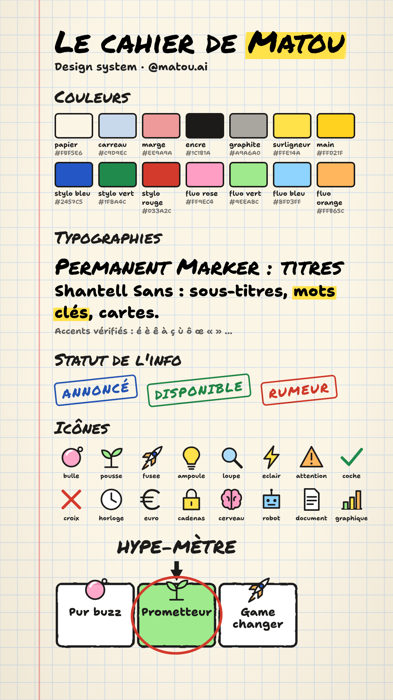

# Design system — « le cahier de Matou »

Source unique des valeurs : [`brand/tokens.json`](../brand/tokens.json). Le moteur vidéo
et les planches ci-dessous le lisent directement : changer une couleur là-bas la change
partout.

| Planche marque | Planche Matou |
| --- | --- |
|  |  |

Régénérer les planches : `npm run stills -- planches`. Régénérer les SVG de Matou et des
icônes dans `brand/` : `npm run brand`.

## L'idée

Matou griffonne l'actu dans son cahier d'écolier. Tout a l'air **fait main** : papier
crème à petits carreaux, marge rouge, trait de feutre noir épais qui « bouillonne »
(le contour est légèrement redessiné 10 fois par seconde), surligneur jaune sur les mots
clés, morceaux de scotch, tampons. Ça raconte la pédagogie, ça se reconnaît en une
image, et ça tranche avec les comptes IA sombres et néon.

## Format et zones de sécurité

- Vidéo verticale **1080 × 1920**, 30 images/s, H.264 + AAC, volume final −14 LUFS.
- Zones cachées par l'interface des réseaux : **220 px en haut, 420 px en bas,
  150 px à droite, 72 px à gauche**. Rien d'important dehors.
- Mise en page fixe, de haut en bas :

| Zone | Y (px) | Contenu |
| --- | --- | --- |
| En-tête | 220–300 | `MATOU #NNN` surligné, série (FLASH / DÉCRYPTÉ), source + date |
| Contenu | 370–1000 | la scène (carte, chiffre, liste, Hype-mètre…) |
| Sous-titres | 1010–1170 | une ligne, mot prononcé au fluo |
| Matou | ~1150–1500 | posé sur la limite basse, se déplace selon la scène |

La composition `EpisodeAvecInterface` superpose une fausse interface TikTok pour le
contrôle (`npm run stills -- <épisode>`).

## Couleurs

| Jeton | Valeur | Usage |
| --- | --- | --- |
| `papier` | `#FBF5E6` | fond |
| `carreau` | `#C9D9EC` | quadrillage (48 px) |
| `marge` | `#EE9A9A` | marge rouge à gauche |
| `encre` | `#1C1B1A` | trait, texte |
| `graphite` | `#A9A6A0` | rayures du front, cicatrice de Matou |
| `surligneur` | `#FFE14A` | mots clés, mot prononcé, numéro d'épisode |
| `main` / `mainContour` | `#FFD21F` / `#C98A00` | la main ☝ de Matou |
| `stylo.bleu` | `#2457C5` | mots clés dans les sous-titres, tampon ANNONCÉ |
| `stylo.vert` | `#1F8A4C` | tampon DISPONIBLE, « après » |
| `stylo.rouge` | `#D33A2C` | tampon RUMEUR, « avant », entourage du verdict |
| `fluo.*` | rose, vert, bleu, orange | fonds d'icônes, cases du Hype-mètre |

Le jaune reste **rare** : un surlignage par carte, deux au plus. S'il est partout, il ne
signale plus rien.

## Typographies

Polices embarquées dans `public/brand/fonts/` (aucun appel réseau au rendu, licences
dans le même dossier).

- **Permanent Marker** — titres, hooks, chiffres, verdict. Toujours en capitales
  (c'est la police qui le fait). Tailles : hook 112, titre 88, chiffre 220.
- **Shantell Sans** — sous-titres, cartes, sources. Graisse 800, axe « informel » à 60
  pour un air écrit à la main. Tailles : sous-titres 68, cartes 60, source 34.

## Matou

Redessiné en vectoriel à partir du dessin original (`brand/references/`). Composant :
`src/mascot/MatouSvg.tsx` (statique) et `src/mascot/Matou.tsx` (animé).

| Expression | Quand |
| --- | --- |
| `neutre` / `parle` | par défaut ; la bouche suit le volume de la voix |
| `enFait` | « En fait… » : index levé, petits traits d'éclat |
| `surpris` | hook, chiffre étonnant |
| `sceptique` | rumeur, promesse floue, verdict « pur buzz » |
| `reflechit` | comparaison, question ouverte |
| `content` | fin, bonne nouvelle |
| `verdict` | Hype-mètre : les verres affichent l'icône du verdict |

Animations permanentes : trait qui bouillonne, respiration, clignement toutes les ~3 s,
petit saut à chaque changement d'expression, glissement d'une place à l'autre entre
les scènes. Les **verres sont des écrans** : yeux, icône (`fusee`, `pousse`, `bulle`…)
ou chargement.

## Composants

| Composant | Fichier | Rôle |
| --- | --- | --- |
| Fond cahier | `src/components/FondCahier.tsx` | papier, carreaux, marge |
| Carte | `src/components/Carte.tsx` | feuille blanche, contour feutre, scotch, ombre |
| Surligneur | `src/components/TexteMarque.tsx` | `==mot==` → fluo qui se dessine de gauche à droite |
| Tampon | `src/components/Tampon.tsx` | ANNONCÉ / DISPONIBLE / RUMEUR, posé d'un coup sec |
| Sous-titres | `src/components/SousTitres.tsx` | une ligne ≤ 24 caractères, mot prononcé au fluo |
| En-tête | `src/components/EnTete.tsx` | numéro, série, source toujours visible |
| Hype-mètre | `src/components/HypeMetre.tsx` | la flèche hésite puis se pose, le stylo rouge entoure |
| Icônes | `src/components/Icones.tsx` | 16 icônes au feutre (pas d'emoji à l'écran) |

Les 9 types de scènes (hook, source, point, chiffre, liste, comparaison, pourquoi,
verdict, fin) sont dans `src/scenes/Scenes.tsx` ; leur catalogue d'usage est dans le
skill `.claude/skills/ecriture-matou/`.

## Mouvement

Entrées rapides et sèches (ressort, ~8 images), jamais de fondu lent. Les visuels
arrivent 4 images avant la voix : l'œil précède l'oreille. La première image de la
vidéo montre déjà le titre du hook (lecture automatique sur les réseaux).

## Son

- Voix : −16 LUFS à la génération, mixage final normalisé à −14 LUFS.
- Musique : boucle marimba / pizzicato à 7 %, fondu d'entrée et de sortie.
- Bruitages (35 %) : feuille qui glisse aux transitions, tampon, « ding » du verdict,
  **signature « Ma-tou ! »** (trois notes de marimba : sol, mi, do) sur l'écran de fin.

Détail et origine des fichiers : `public/brand/sons/LISEZMOI.md`.
