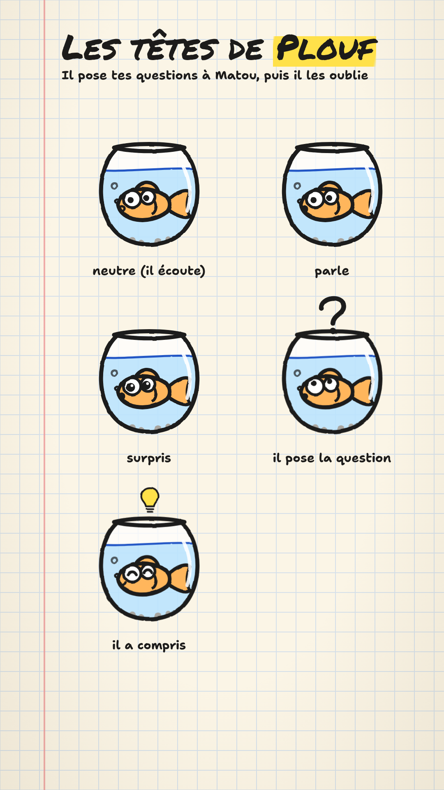

# Le duo Matou et Plouf (prototype, 11/11/2026)

Branche d'essai `prototype-duo-plouf`. Rien n'entre dans les routines tant que
l'utilisateur ne l'a pas validé.



## L'idée : un duo de vulgarisation

Modèle : les duos des émissions de vulgarisation (*C'est pas sorcier*, France 3, 1993-2014).
L'un va chercher la question du public, l'autre explique avec ses maquettes. L'émission
a commencé à trois et a fini en duos (Jamy avec Fred, ou Jamy avec Sabine). Les maquettes
étaient son identité : la formule 2011-2012 qui les a remplacées par de la 3D a été
abandonnée. On reprend le **principe**, rien de l'émission (ni noms, ni décor, ni phrases).

| | Rôle | Chez nous |
| --- | --- | --- |
| **Matou** | celui qui explique | inchangé : « En fait… », l'avis, le Hype-mètre. Ses cartes sont ses maquettes |
| **Plouf**, le poisson rouge | celui qui pose la question du spectateur | il apporte l'actu (« Il paraît que… C'est vrai ? »), relance (« Et pour moi, ça change quoi ? »), et oublie tout : « Attends… c'était quoi la question ? » relance la boucle de fin |

Règles d'écriture proposées : Plouf dit **une à trois répliques courtes** (≤ 120
caractères), toujours **avant** celle de Matou dans la scène ; il ne dit que ce que dit la
source (il pose la question, il n'affirme rien) ; le verdict reste à Matou. Ses mots sont
surlignés en orange dans les sous-titres, ceux de Matou en jaune.

## Comment ça marche dans le moteur

- `scenes.json` : par scène, `plouf` (sa réplique) et `ploufEtat` (son expression pendant
  que Matou parle : `neutre`, `surpris`, `compris`…). Une scène avec `plouf` met tout
  l'épisode en duo : Plouf à gauche, Matou à droite.
- `timings.json` : chaque mot a son `locuteur` ; `enveloppe` anime la bouche de Matou,
  `enveloppePlouf` celle de Plouf.
- Pendant la réplique de Plouf, Matou écoute (`neutre`) ; Plouf prend `question` si sa
  réplique finit par « ? », sinon `parle`.
- Composants : `src/personnages/PloufSvg.tsx` (dessin, 5 expressions) et `Plouf.tsx`
  (animé : le bocal flotte, le poisson nage, bulles, clignements).

## Décor alternatif : le bureau de Matou

`"decor": "bureau"` remplace le cahier par un **lieu fixe** : un mur en liège où les cartes
sont punaisées, et le bureau en bois où Matou et Plouf sont posés, sous la lumière d'une
lampe (`src/components/FondBureau.tsx`). Les cartes, l'encre et le surligneur ne changent
pas. L'idée vient du même modèle : un plateau qu'on reconnaît en une image, et où le
bocal de Plouf a une place naturelle.

## La voix d'essai (gratuite)

`scripts/prototype/voix-libre.py` fait les deux voix avec **Piper** (synthèse libre, hors
ligne) : Matou = `fr_FR-tom-medium`, Plouf = `fr_FR-siwis-medium` monté d'environ 2,5
demi-tons. Le minutage des mots est estimé (chaque phrase est synthétisée seule, puis
répartie au prorata des phonèmes). C'est pour juger le format, pas pour publier : la
qualité est en dessous de la voix de Matou, et `npm run check` refuse cette voix.

```bash
pip install piper-tts   # puis télécharger les .onnx et .onnx.json depuis huggingface.co/rhasspy/piper-voices (fr/fr_FR)
python3 scripts/prototype/voix-libre.py prototypes/903-duo-plouf --voix <dossier des .onnx>
npm run render -- prototypes/903-duo-plouf
```

Épisodes d'essai : `prototypes/903-duo-plouf` (cahier) et `prototypes/904-duo-plouf-bureau`
(bureau), sur les faits de #021 (feux rouges, blog NVIDIA du 2 nov. 2026).

## Pour passer en production (pas encore fait)

1. Une voix pour Plouf dans `brand/voix.json` (casting comme celui de Matou), et `npm run
   voice` qui lit les deux voix (deux appels, puis le même alignement).
2. `validate` : les règles ci-dessus (nombre et longueur des répliques, jamais le verdict).
3. Le skill `ecriture-matou` : quand faire parler Plouf.
4. Un test sur une semaine, comme le rythme posé : duo un épisode sur deux, comparé au solo.
