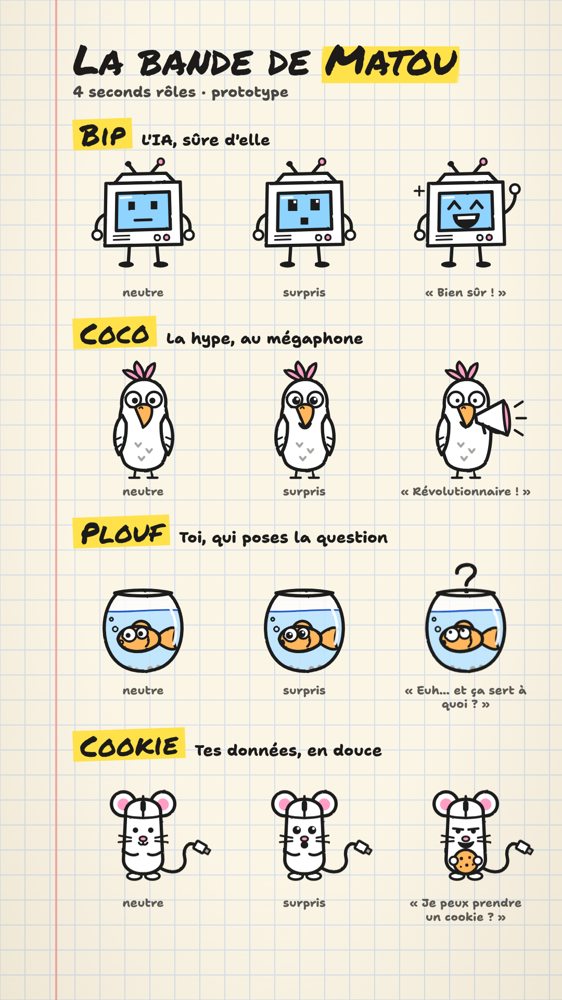
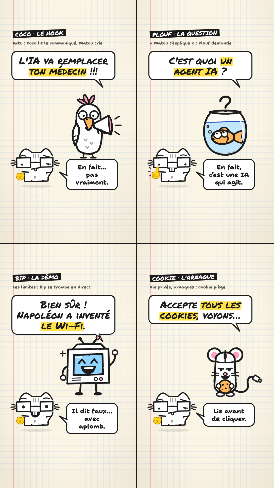

# La bande de Matou (prototype, 11/11/2026)

Quatre seconds rôles, dessinés comme Matou : feutre noir qui bouillonne, corps blanc, une
seule couleur d'accent chacun (prise dans les fluos de `brand/tokens.json`). Matou reste
la marque et celui qui explique ; les autres lui donnent la réplique. Rien n'est encore
branché dans les épisodes : ce sont des dessins et des maquettes.

| Planche | En situation |
| --- | --- |
|  |  |

Composants : `src/personnages/Bande.tsx` (états `neutre`, `parle`, `surpris`,
`signature`) ; planches : `src/personnages/Planches.tsx` (`npm run stills -- planches`).

## Qui fait quoi

| Personnage | Il joue | Sa réplique type | Où il sert |
| --- | --- | --- | --- |
| **Coco**, le perroquet au mégaphone (crête rose, bec orange) | La hype : il répète le communiqué ou le titre racoleur | « Révolutionnaire ! » | Le hook des épisodes d'actu : il crie la promesse, Matou trie (« En fait… »). Clin d'œil au « perroquet stochastique » |
| **Plouf**, le poisson rouge dans son bocal | Le spectateur : il pose la question qu'on n'ose pas poser, et l'oublie trois secondes après | « Euh… et ça sert à quoi ? » | La série « Matou t'explique » : Plouf demande, Matou répond. Sa mémoire courte sert à expliquer la « mémoire » d'une IA |
| **Bip**, le vieil écran sur pattes (écran bleu) | L'IA elle-même : serviable, sûre d'elle, parfois fausse avec aplomb | « Bien sûr ! » | Les démonstrations et les limites (« Matou t'écrit ») : Bip répond, Matou vérifie |
| **Cookie**, la souris d'ordinateur (oreilles roses, queue en câble) | Ce qui ramasse tes données : bannières, arnaques, conditions d'utilisation | « Je peux prendre un cookie ? » | Les sujets vie privée et arnaques. Un chat contre une souris : le duel se comprend sans un mot |

## Pourquoi des seconds rôles

- **Un désaccord dès la 1re seconde.** 58,8 % des spectateurs YouTube balaient (capture du
  10/11). Un hook à deux voix (Coco crie, Matou lève un sourcil) pose un conflit qu'on
  veut voir tranché, là où un titre seul s'explique.
- **Le spectateur a un visage.** Plouf dit « je n'ai pas compris » à sa place, sans qu'on
  le prenne de haut.
- **Des épisodes qui se reconnaissent.** Un personnage récurrent donne un rendez-vous
  (« l'épisode où Coco s'emballe ») et des commentaires (« Coco a encore crié »).
- **Matou reste Matou.** Le nom, le compte `@matou.ai`, l'avatar et 25 épisodes reposent
  sur lui : le remplacer reviendrait à relancer la chaîne de zéro.

## Pour les brancher (pas encore fait)

1. Une 2e voix de synthèse par personnage (casting comme celui de Matou, `brand/voix.json`),
   et un champ `locuteur` par réplique dans `scenes.json` ; la bouche de chacun suit sa voix.
2. Une scène « duo » : le second rôle en haut, Matou en bas, une bulle chacun.
3. Une règle d'écriture : un second rôle au plus par épisode, 1 ou 2 répliques, jamais le
   dernier mot (le verdict reste à Matou). Coco ne dit que ce que dit la source (le titre
   ou le communiqué cité) : il incarne la promesse, il n'en invente pas.
